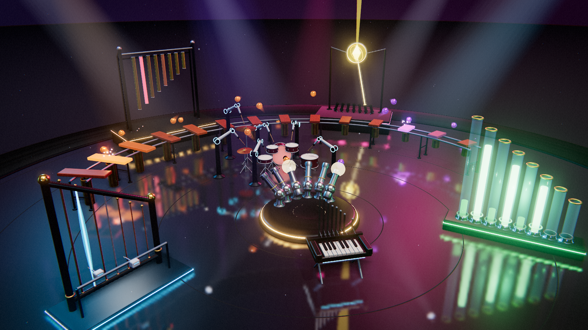

# Animusic — prototype



Génère une scène 3D animée dans l'esprit d'*Animusic* (Pipe Dream) à partir d'un fichier MIDI :
des canons tirent des billes qui retombent pile sur des lames de marimba, des bras robotisés jouent la
batterie, des médiators pincent des cordes de basse, des tubes d'orgue s'illuminent sur les notes tenues, des
marteaux font sonner un carillon de cloches tubulaires, une harpe laser tire un rayon par note vers un cristal
et un clavier mécanique enfonce ses touches tout seul — le tout sur une scène éclairée comme un concert.

**En ligne : https://drschizzo.github.io/animusic/** (déployé automatiquement par GitHub Actions).

## Utilisation

- Glisse un `.mid` sur la page (ou « Ouvrir… ») ; une démo se charge au démarrage.
- **Ou un enregistrement** (`.mp3`, `.wav`, `.ogg`, `.flac`…) : il est transcrit dans le navigateur (rien n'est
  envoyé nulle part), puis la scène est animée **sur le vrai son** ; un sélecteur permet d'écouter la transcription.
- Chaque piste reçoit automatiquement un instrument (**Billes**, **Basse**, **Orgue**, **Carillon**,
  **Harpe laser**, **Clavier**, **Batterie**), modifiable dans la liste des pistes, ou **Masquée**.
  Plusieurs pistes peuvent partager le même instrument.
- **Caméra** : *Réalisateur* (plans automatiques), *Orbite*, ou *Libre* (souris). Toucher la vue passe en libre.
- **Barre de lecture** pour naviguer dans le morceau ; **Retard image** pour corriger une latence audio mal
  annoncée (Bluetooth) ; **Qualité** *Auto* part de *Haute* (reflets du sol, ombres 4K, occlusion ambiante, halo) et descend d'un cran
  si l'animation rame.
- **Sons réalistes** : échantillons General MIDI (SoundFont FluidR3), sinon synthèse.
- **⏺ Vidéo** : rejoue le morceau et l'enregistre (image + son) en MP4 ou WebM.
- **⇩ Blender** : exporte l'animation complète en glTF (`.glb`).

## Développement

```bash
npm install
npm run dev        # http://localhost:5173
npm test           # tests unitaires (chorégraphie, instruments, arrangeur, réalisateur)
npm run build && npm run smoke   # build + test de fumée dans Chromium (comme en CI)
npm run bench -- morceau.mid     # banc d'essai : arrangement, NaN, coût par image
```

## Principe : l'animation à l'envers

Comme dans MIDImotion (l'outil d'Animusic), rien n'est simulé : tout est **calculé à l'avance à partir des notes**,
puis la scène est posée à l'instant `t` lu sur l'horloge audio.

- **Billes** : tir à `t − T`, vitesse initiale `v0 = (cible − départ + ½·g·T²·ŷ) / T` → parabole exacte ;
  le canon le plus proche et libre vise juste avant de tirer.
- **Batterie** : un bras à deux segments par élément, pose de frappe par cinématique inverse ; la baguette se lève
  avant le coup (plus haut si le coup est fort et espacé) et touche la peau pile à l'instant de la note.
- **Basse** : des chariots glissent devant la corde suivante pendant que le médiator est au repos, puis il traverse
  la corde à l'instant exact (aller, puis retour au coup suivant) ; la corde vibre avec un flou de mouvement.
- **Orgue** : la valve s'ouvre avant la note, la colonne de lumière dure autant que la note.
- **Carillon** : un marteau par cloche recule puis frappe le haut du tube à l'instant de la note ; la cloche se
  balance ensuite comme un pendule amorti (somme des réponses aux frappes récentes, donc sans à-coup).
- **Harpe laser** : l'iris de l'émetteur s'ouvre avant la note, le rayon dure autant qu'elle ; le cristal brille
  de la somme des rayons reçus et éclaire réellement la scène.
- **Clavier** : la touche s'enfonce juste avant la note et remonte avant d'être rejouée ; derrière, un marteau
  frappe une lame vibrante par touche jouée.
- **Réalisateur** : la liste des plans est calculée pour tout le morceau ; chaque segment cadre l'instrument le plus
  actif par rapport à son niveau habituel (bonus à son entrée), en alternant plans larges, rapprochés, contre-plongées.

## Répartition automatique des pistes

Le programme General MIDI donne un indice, les statistiques des notes tranchent (`src/arranger.js`) :

| Instrument | Pistes concernées |
|---|---|
| Batterie | canal de percussion |
| Basse | basses (32-39), violoncelle / contrebasse monodiques, ligne grave monodique, ou voix nettement plus grave que les autres |
| Carillon | célesta, glockenspiel, boîte à musique, vibraphone, cloches tubulaires, kalimba |
| Harpe laser | soliste aux notes tenues : violon, cuivres, anches, flûtes, leads de synthé |
| Orgue | nappes, orgues et ensembles aux notes longues, accords tenus |
| Clavier | pianos (0-7) |
| Billes | tout le reste (marimba, xylophone, guitares, harpe…) ; sans cela, la piste de clavier la plus fournie |

## Rendu

- **Sol** : plateau poli dont la rugosité varie ; il reflète la scène par un rendu miroir, lu d'autant plus flou
  que la surface est rugueuse.
- **Lumière** : carte d'environnement « studio » générée au démarrage (boîtes à lumière), lumière principale avec
  ombres douces 4K, contre-jours colorés, lampes ponctuelles pilotées par la musique (orgue, cristal, frappes des
  lames), projecteurs à faisceaux volumétriques et bordure de scène qui pulsent avec la grosse caisse.
- **Matériaux** physiques (laque sous vernis, métal brossé, verre, bois veiné) à textures procédurales : aucun
  fichier image.
- **Effets** : traînées et étincelles d'impact des billes (déterministes : identiques à chaque passage), éclair de
  bouche des canons, poussières en suspension.
- **Post-traitement** : rendu HDR anticrénelé (MSAA 4×), occlusion ambiante GTAO, halo, vignettage, aberration
  chromatique légère, grain, conversion ACES.

## Import audio (mp3 → animation)

1. **Notes** : [Basic Pitch](https://github.com/spotify/basic-pitch) (Spotify, Apache-2.0), réseau de neurones léger
   exécuté avec TensorFlow.js (chargé seulement à l'import d'un fichier audio, modèle servi dans `public/models/`).
2. **Batterie** (`src/drumDetect.js`, dans un Web Worker) : spectrogramme, séparation harmonique / percussive (HPSS,
   filtres médians), puis montées d'énergie par bande — grave → grosse caisse, 180-3000 Hz → caisse claire,
   5-11 kHz → charleston. Si l'aigu ne contient presque pas d'énergie percussive (piano, cordes…), on conclut à
   l'absence de batterie.
3. **Répartition** (`src/audioArrange.js`) : la note la plus grave de chaque attaque, sous un seuil relatif au morceau,
   va à la basse ; les notes longues à l'orgue ; le reste aux billes (polyphonie limitée).
4. **Lecture** de l'enregistrement original, calé sur le transport (pause, saut et vidéo suivent).

Précision mesurée par `tools/audio-bench.cjs` sur des rendus FluidSynth dont la partition est connue (F1, attaque à
± 50 ms) : notes à la hauteur exacte 50-85 % selon les morceaux (piano seul ≈ 85 %, mix dense ≈ 50 %), basse 30-65 %,
grosse caisse ≈ 90 %, caisse claire ≈ 93 %, charleston 60-80 %, aucun coup fantôme sur piano ou cordes seuls.
C'est fait pour animer, pas pour obtenir une partition : on entend toujours le vrai morceau.

## Synchro image / son

L'image est calée sur l'échantillon **réellement en train de sortir des haut-parleurs**
(`AudioContext.getOutputTimestamp()`, à défaut `currentTime − outputLatency`), et non sur l'horloge de
programmation de Tone.js qui a ~0,1 s d'avance. Pendant un enregistrement vidéo, le son étant capté à la source,
l'image suit l'horloge de rendu audio.

## Architecture

| Fichier | Rôle |
|---|---|
| `src/midi.js` | Lecture MIDI (`@tonejs/midi`) → pistes / notes / programme ; morceau de démo |
| `src/arranger.js` | Rôle de chaque piste (programme GM + statistiques + passe globale), construction et placement des instruments |
| `src/choreography.js`, `src/drums.js`, `src/strings.js`, `src/pipes.js`, `src/bells.js`, `src/laser.js`, `src/keys.js` | **Cœurs purs, sans Three.js** : mouvements calculés de chaque instrument |
| `src/director.js` | **Pur** : plans caméra et pose de la caméra à l'instant t |
| `src/*View.js` | Rendu Three.js de chaque instrument |
| `src/scene.js` | Scène, qualité ; instancie la vue de chaque instrument |
| `src/environment.js` | Décor : sol réfléchissant, éclairage, fond, projecteurs volumétriques, poussières |
| `src/postfx.js` | Post-traitement : MSAA HDR, occlusion ambiante (GTAO), halo, objectif, ACES |
| `src/materials.js`, `src/parts.js` | Matériaux physiques, textures procédurales, pièces de construction partagées |
| `src/audio.js` | Tone.js : échantillons GM, synthèse de secours, horloge de référence, capture pour la vidéo |
| `src/exporter.js` | Export glTF (animation cuite) |
| `src/audioImport.js`, `src/transcribe.js`, `src/drumDetect.js`, `src/audioArrange.js` | Import d'un enregistrement : décodage, transcription, batterie, répartition |
| `src/main.js` | Interface et boucle de rendu |

Outils : `tools/make-samples.mjs` (génère les échantillons avec FluidSynth), `tools/bench.mjs`,
`tools/smoke.mjs`, `tools/shot.mjs` (captures d'écran à un instant donné), `tools/stress-midi.mjs` (fichiers MIDI de stress), `tools/audio-bench.cjs` (précision de l'import
audio : `node tools/audio-bench.cjs morceau.mp3` à côté de `morceau.mid`, ffmpeg requis).

## Export vers Blender

*Fichier → Importer → glTF 2.0* puis choisir le `.glb`. On y trouve tous les instruments (noms préfixés
`billes_`, `batterie_`, `basse_`, `orgue_`, `carillon_`, `harpe_laser_`, `clavier_`, `bille_pisteN_k`) et la caméra animée `camera_realisateur`
(à définir comme caméra active). L'animation est échantillonnée à 30 img/s ; le décalage du son par rapport au
début de l'animation est indiqué dans le message d'export et dans les propriétés personnalisées de la racine
(`animusic.decalageAudioSecondes`). Non exportés : décor (sol, fond, projecteurs), lumières et effets lumineux
(émission animée, rayons laser, traînées, étincelles : non standard en glTF) — à recréer dans Blender.

## Sons et modèles

Les échantillons de `public/samples/` sont extraits du SoundFont *Fluid (R3) General MIDI* de Frank Wen,
sous licence MIT (voir `public/samples/LICENSE.txt`). Le modèle de transcription de `public/models/basic-pitch/`
est celui de Basic Pitch (Spotify), sous licence Apache-2.0. Pour régénérer les échantillons :

```bash
sudo apt-get install fluidsynth fluid-soundfont-gm ffmpeg
npm run samples
```

## Déploiement

`.github/workflows/deploy.yml` teste, construit, lance le test de fumée dans Chromium, puis publie sur GitHub Pages
à chaque push sur la branche par défaut.
